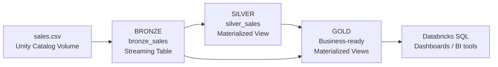

# Retail Sales Data Engineering Pipeline


An end-to-end **Medallion Architecture (Bronze → Silver → Gold)** pipeline built on Databricks with **Lakeflow Spark Declarative Pipelines** and SQL. It turns a raw retail sales CSV into trusted, business-ready reporting tables, with data-quality checks and cross-layer reconciliation built in.

---

## Table of Contents

1. [Business Problem](#business-problem)
2. [Architecture](#architecture)
3. [Tech Stack](#tech-stack)
4. [Repository Structure](#repository-structure)
5. [Pipeline Layers](#pipeline-layers)
6. [Gold Tables](#gold-tables)
7. [Data Quality and Reconciliation](#data-quality-and-reconciliation)
8. [How to Run](#how-to-run)
9. [Example Queries](#example-queries)
10. [Design Notes and Limitations](#design-notes-and-limitations)
11. [Future Improvements](#future-improvements)
12. [What I Learned](#what-i-learned)
13. [Author](#author)

---

## Business Problem

A retail business receives sales data as CSV files and wants **reliable, repeatable reporting** on sales, profit, products, customers, geography and sales channels.

The source file has common data-quality problems: inconsistent text, missing values, duplicate records and invalid numeric values. This project preserves the raw data, cleans and validates it, and publishes analytics-ready tables that BI tools and SQL users can query directly.

**Source data:** `sales.csv`, 1,506 rows and 33 columns (orders, customers, geography, products, pricing, cost, profit, payment, channel, status, rating).

---

## Architecture



| Layer | Object | Type | Purpose |
|-------|--------|------|---------|
| Bronze | `bronze_sales` | Streaming Table | Raw ingestion with audit metadata |
| Silver | `silver_sales` | Materialized View | Cleaned, typed, validated, deduplicated |
| Gold | 10 `gold_*` views | Materialized Views | Business analytics + data-quality reporting |

---

## Tech Stack

- **Databricks** (Lakeflow Spark Declarative Pipelines)
- **SQL** (CTEs, window functions, `QUALIFY`, `GROUP BY ALL`, `TRY_CAST`)
- **Unity Catalog Volumes** for source file storage
- **Auto Loader-compatible ingestion** via `read_files()`
- **Pipeline expectations** for data-quality monitoring

---

## Repository Structure

```
retail-sales-lakeflow-medallion-pipeline/
├── README.md
├── LICENSE
├── .gitignore
├── pipelines/
│   ├── 01_bronze/
│   │   └── bronze_sales.sql          # Raw ingestion (streaming table)
│   ├── 02_silver/
│   │   └── silver_sales.sql          # Cleaning, typing, dedup (materialized view)
│   └── 03_gold/
│       └── gold_analytics.sql        # 10 business + data-quality views
├── sql/
│   └── validation_queries.sql        # Post-run checks
└── docs/
    ├── data-dictionary.md            # Column-level mapping Bronze → Silver
    ├── data-quality.md               # All DQ rules in one place
    └── images/                       # Pipeline run / lineage screenshots
```

---

## Pipeline Layers

### Bronze: Raw Ingestion

[`pipelines/01_bronze/bronze_sales.sql`](pipelines/01_bronze/bronze_sales.sql)

- Reads CSV files from a Unity Catalog Volume with `read_files()` and `header => true`.
- Keeps every source column exactly as received (full traceability).
- Adds audit metadata: `source_file` (file path) and `ingested_at` (ingestion timestamp).
- Expectation `data_loaded` monitors missing `OrderID` values without dropping rows.

### Silver: Cleaned and Validated

[`pipelines/02_silver/silver_sales.sql`](pipelines/02_silver/silver_sales.sql)

- `TRIM()` removes leading and trailing spaces from text columns.
- `TRY_CAST()` converts raw values to proper types (`DATE`, `INT`, `DECIMAL`, `BOOLEAN`); failed conversions become `NULL` instead of failing the pipeline.
- Columns are renamed to `snake_case`.
- Invalid rows are filtered out (see [Data Quality](#data-quality-and-reconciliation)).
- Deduplicates with `ROW_NUMBER()` and `QUALIFY`, keeping the latest-ingested record per `OrderID` + `ProductID`.

### Gold: Business Analytics

[`pipelines/03_gold/gold_analytics.sql`](pipelines/03_gold/gold_analytics.sql)

Ten materialized views built from Silver (the data-quality views also read Bronze). See the next section.

---

## Gold Tables

| View | Grain | What it answers |
|------|-------|-----------------|
| `gold_monthly_sales_trends` | Year, month | How do sales, profit and volume move over time? |
| `gold_product_performance` | Product | Which products sell, earn and rate best? |
| `gold_sales_by_category` | Category, sub-category | Which categories drive revenue and margin? |
| `gold_sales_by_region` | Region, state | Where are sales, profit and unique customers? |
| `gold_top_products` | Product | Products ranked by total sales and by total profit |
| `gold_segment_performance` | Customer segment | Which customer segments are most valuable? |
| `gold_channel_performance` | Sales channel | Which sales channels perform best? |
| `gold_data_quality_summary` | Layer | Row counts for Bronze vs Silver |
| `gold_dq_issues` | Issue type | How many raw rows have each type of problem? |
| `gold_reconciliation` | Layer | Do row counts agree across layers (PASS / FAIL)? |

Profit margin is calculated as `SUM(profit) / SUM(sales) * 100`, guarded against division by zero.

---

## Data Quality and Reconciliation

Quality is handled at three levels. Full details are in [`docs/data-quality.md`](docs/data-quality.md).

1. **Expectations (monitoring):** Bronze and Silver declare `CONSTRAINT ... EXPECT` rules. Their metrics are recorded in the pipeline event log, and rows are not dropped by the expectation alone.
2. **Filtering and deduplication (enforcement):** Silver removes rows with a missing order ID, an invalid order date, non-positive sales or quantity, or an unusable profit value, then deduplicates.
3. **Reporting (transparency):** Gold exposes `gold_dq_issues` (what was wrong in the raw data) and `gold_reconciliation` (do the layers agree).

The difference between Bronze and Silver row counts covers all removed rows (invalid and duplicate), not duplicates alone.

---

## How to Run

**Prerequisites:** a Databricks workspace with Unity Catalog and permission to create pipelines.

1. **Create the catalog, schema and volume** (the source path used in the Bronze file is `/Volumes/retail_sales_sdp/default/sales_volume`):
   ```sql
   CREATE CATALOG IF NOT EXISTS retail_sales_sdp;
   CREATE VOLUME IF NOT EXISTS retail_sales_sdp.default.sales_volume;
   ```
2. **Upload `sales.csv`** into that volume.
3. **Create a pipeline** (Jobs & Pipelines → ETL pipeline), choose SQL, and add the three files in `pipelines/` as source code. Dependencies between `bronze_sales`, `silver_sales` and the Gold views are resolved automatically.
4. **Run the pipeline** and open the pipeline graph to confirm all datasets completed.
5. **Validate** the outputs with [`sql/validation_queries.sql`](sql/validation_queries.sql).

> If your catalog, schema or volume names differ, update the path in `pipelines/01_bronze/bronze_sales.sql`.

---

## Example Queries

Top 20 products by sales:

```sql
SELECT *
FROM gold_top_products
ORDER BY sales_rank, product_id
LIMIT 20;
```

Check that every layer reconciles:

```sql
SELECT * FROM gold_reconciliation;
```

Monthly trend:

```sql
SELECT *
FROM gold_monthly_sales_trends
ORDER BY order_year, order_month;
```

---

## Design Notes and Limitations

- **Deduplication key.** Silver assumes one valid row per `OrderID` + `ProductID`. If the same product can appear on several legitimate lines of one order, a line-item identifier would be a better business key.
- **`order_count` is a row count.** `COUNT(*)` counts Silver rows, not distinct orders.
- **Text standardization is whitespace-only.** `TRIM()` is applied, but case variants (for example `electronics` vs `Electronics`) are not normalized, so they would form separate groups in Gold.
- **Ranking ties.** `RANK()` lets tied products share a rank. The top-N limit is applied when querying, not inside the view.
- **Expectations monitor, filters enforce.** Expectations record violations; the `WHERE` clause in Silver is what removes rows.

---

## Future Improvements

- Add a quarantine table that stores rejected rows with the reason for rejection.
- Normalize text case for categorical columns.
- Build a Databricks SQL dashboard or Power BI report on top of the Gold views.
- Use a line-item identifier for deduplication if the source provides one.
- Schedule the pipeline and add alerting on failed expectations.

---

## What I Learned

- Designing a Medallion architecture and deciding what belongs in each layer
- Building declarative pipelines with streaming tables and materialized views
- Writing data-quality rules, and understanding expectations vs. filtering
- Reconciling row counts across layers so numbers can be trusted
- Documenting a data project so others can run and review it

---

## Author

**Vamsi Bodigadla**, BCA graduate (2026) with a Data Analytics background (Python, SQL, Power BI, Excel), now building data engineering skills.

- LinkedIn: [vamsi-bodigadla-717330244](https://www.linkedin.com/in/vamsi-bodigadla-717330244)
- GitHub: [u200cbvt](https://github.com/sarvendhra-vamsi)

Licensed under the [MIT License](LICENSE).
